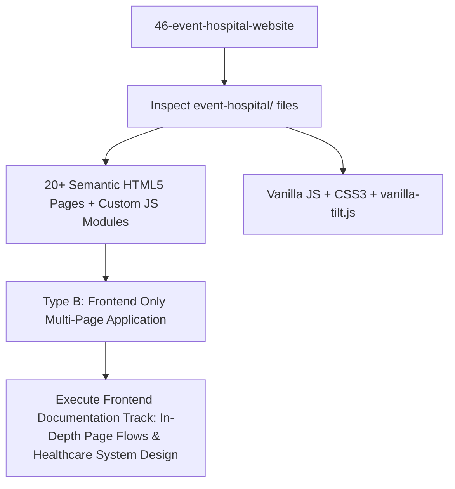

# Project Type Pre-Check: 46-Event-Hospital-Website

## Step 0 Pre-Check Analysis

- **Detected Track**: **Track B: Frontend Only (Multi-Page Hospital Information System & Patient Services Portal)**
- **Project Root**: `/Users/avishjain/avishjain9-repos/46-event-hospital-website`
- **Application Directory**: `event-hospital/sachidaanand hospita; 3/`
- **Primary Domain**: Comprehensive multi-department hospital portal providing patient registration, telehealth video consultations, emergency SOS dispatch, pharmacy e-commerce, and specialized disease resource centers.

### Evidence Matrix

| Evidence Factor | Codebase Artifact | Findings | Verdict |
|---|---|---|---|
| **Page Inventory** | `event-hospital/sachidaanand hospita; 3/` | 21 HTML pages (`main.html`, `docter.html`, `patientportal.html`, `videoconsultation.html`, `emergency.html`, `bmi.html`, `ADMINFORM.html`) | Multi-page clinical and patient portal. |
| **Scripts & Logic** | `*.js` in directory | `docter.js`, `ADMINFORM.js`, `bmi.js`, `videoconsultation.js`, `vanilla-tilt.js` | Client-side DOM form validation, calculations, WebRTC UI, interactive cards. |
| **Backend Code** | Entire Repository | No custom backend HTTP listener or database server. Forms simulate client-side workflows. | **Not applicable** (Frontend-only track). |
