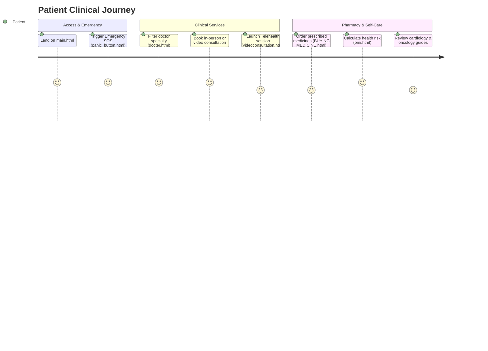

# Full Project Analysis: Sachidaanand Hospital Portal

## 0.1 What the Project Is

**Sachidaanand Hospital Portal** is an integrated healthcare management and patient-facing medical ecosystem. It streamlines hospital administrative admissions, doctor appointment bookings, emergency SOS calls, remote teleconsultations, pharmacy fulfillment, and health monitoring tools into a cohesive web portal.

### Main User Journeys

---

## 0.2 Master Feature Inventory & Traces

### F1: Hospital Command Center (`main.html`)
- **Trace**: Main entrance hub rendering 24/7 helpline, department highlights (Cardiology, Oncology, Pulmonology), doctor directory link, emergency ambulance hotline, and testimonials.

### F2: Doctor Appointment Booking & Scheduling (`docter.html`, `docter.js`)
- **Trace**: Search doctor by specialty, view qualification badges, select date/time slots, and submit consultation request.

### F3: Emergency Dispatch & SOS Panic Trigger (`emergency.html`, `panic_button.html`)
- **Trace**: High-contrast emergency UI providing one-click GPS coordinate sharing and direct ambulance dispatch dialer.

### F4: Telehealth & Remote Video Consultation Room (`videoconsultation.html`, `videoconsultation.js`)
- **Trace**: WebRTC video interface with audio/video mute controls, chat messaging drawer, and doctor status indicator.

### F5: Administrative Hospital Admission & Staff Form (`ADMINFORM.html`, `ADMINFORM.js`)
- **Trace**: Validates patient demographic records, insurance policy numbers, attending physician assignment, and bed allocation.

### F6: Interactive BMI & Metabolic Health Calculator (`bmi.html`, `bmi.js`)
- **Trace**: User inputs height (cm) and weight (kg); calculates $BMI = weight / (height/100)^2$; renders interactive colored risk gauge (Underweight, Normal, Overweight, Obese).

### F7: Online Pharmacy & E-Prescription Fulfillment (`BUYING MEDICINE (2) (1).html`)
- **Trace**: Medicine search catalog, dosage selection, prescription upload preview, cart checkout, and digital invoice calculation.

---

## 0.3 Final Inventory Counts

| Architectural Metric | Count | Code Verification Reference |
|---|---|---|
| **HTML5 Portal Pages** | 21 | `main.html`, `docter.html`, `ADMINFORM.html`, `videoconsultation.html`, etc. |
| **JavaScript Modules** | 8 | `docter.js`, `ADMINFORM.js`, `bmi.js`, `videoconsultation.js`, `vanilla-tilt.js`, etc. |
| **Clinical Specialties Covered** | 5 | Cardiology, Oncology, Pulmonology, Gastroenterology, General Medicine |
| **Interactive Calculators & Tools** | 2 | BMI Health Index, Emergency SOS Dispatch |
