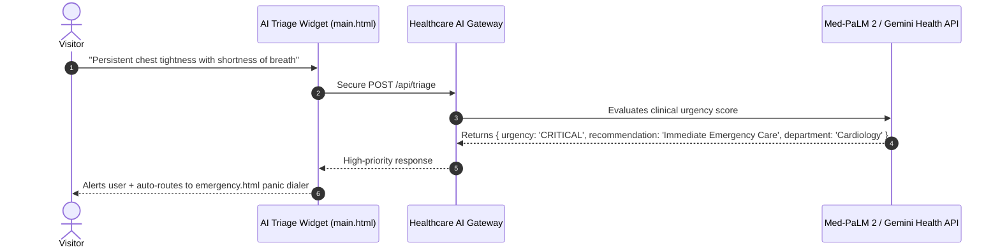

# AI Integration Analysis: Sachidaanand Hospital

## Current Status: No AI Integration

The repository currently contains **No AI integration**.

---

## Architectural Blueprint: AI Triage Assistant & Symptom Checker

