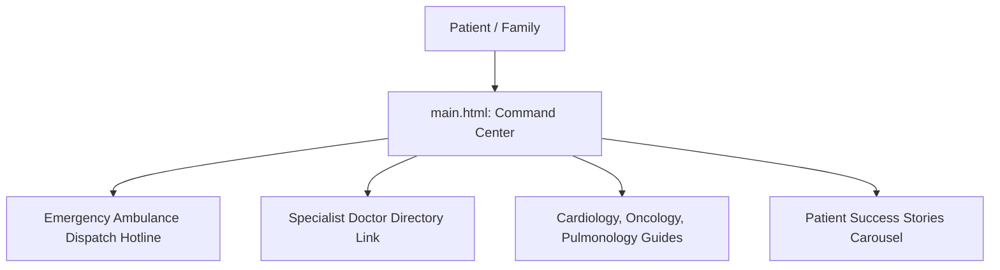

# F1: Hospital Command Center Landing

## Overview & Architecture
Central multi-column medical landing page (`main.html`) presenting emergency ambulance hotlines, clinical specialty highlights, physician search links, and patient testimonials.

## Say It Out Loud
> "I developed the primary hospital command center in `main.html` to serve as an intuitive triage entrance. The interface highlights critical 24/7 emergency helplines prominently above the fold. From the hero section, patients can immediately route to physician scheduling, explore clinical departments, or access emergency ambulance services with a single click."
