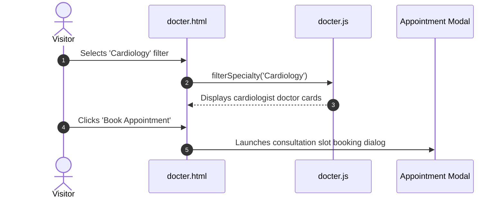

# F2: Doctor Scheduling & Appointment Booking

## Overview & Architecture
Interactive doctor directory (`docter.html`, `docter.js`) allowing patients to filter medical specialists by discipline, inspect credentials, and select available consultation slots.

## Say It Out Loud
> "For outpatient consultations in `docter.html` and `docter.js`, I built an interactive doctor scheduling module. Patients can filter through medical specialists by department, review verified qualifications, and select convenient morning or evening time slots. The appointment form validates patient contact details and displays an immediate booking confirmation."
