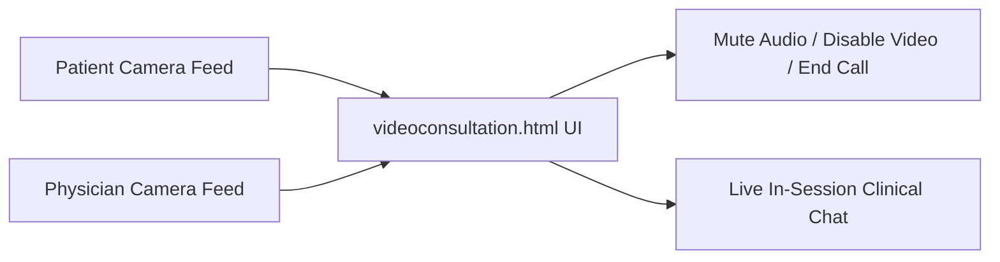

# F3: Telehealth & Remote Video Consultation Room

## Overview & Architecture
A remote patient consultation suite (`videoconsultation.html`, `videoconsultation.js`) simulating a WebRTC teleconsultation room with media toggles, active speaker views, and in-call messaging.

## Say It Out Loud
> "In `videoconsultation.html` and `videoconsultation.js`, I developed a dedicated telehealth consultation room. Designed for remote clinical visits, the interface features camera and microphone toggle controls, a large primary video monitor for the attending physician, a secondary self-preview window, and a synchronized text chat panel for sharing prescription details during the call."
