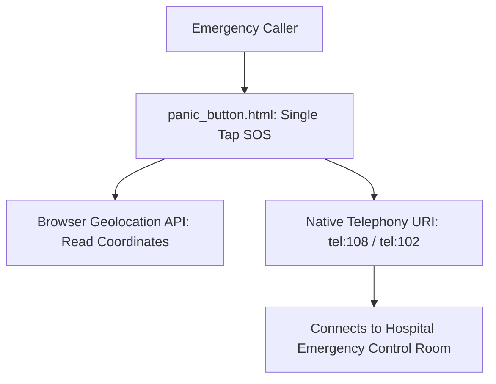

# F4: Emergency SOS & Ambulance Hotline

## Overview & Architecture
Emergency dispatch portal (`emergency.html`, `panic_button.html`) engineered for rapid response, immediate carrier telephony linking (`tel:108`), and real-time GPS coordinate transmission.

## Say It Out Loud
> "To handle critical medical emergencies, I created `panic_button.html` and `emergency.html`. When an individual faces an urgent health crisis, cognitive load must be minimized. The panic button utilizes high-contrast emergency red styling. Tapping the button captures browser geolocation coordinates and immediately triggers the mobile device's native telephone dialer to dispatch the nearest hospital ambulance."
