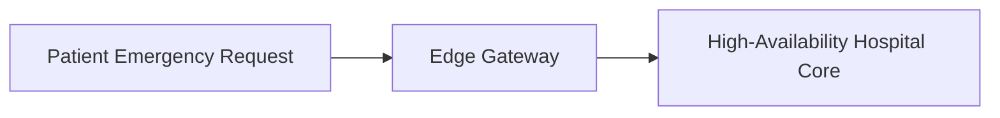

# 14.4: Load Balancing And Scaling

## 1. Overview & Context in Hospital Systems
This module analyzes `load-balancing-and-scaling` applied specifically to the Sachidaanand Hospital healthcare platform.

## 2. Technical Evaluation & Comparison
| Strategy / Choice | Chosen Implementation | Alternative A | Alternative B | Trade-Off Accepted |
|---|---|---|---|---|
| **Clinical Portal Architecture** | Static Multi-Page Portal | Monolithic SPA | Micro-Frontend Suite | Maximum page load reliability across poor mobile networks accepted over SPA single-load hydration. |
| **Emergency Hotline Flow** | Direct Native Telephony Links (`tel:`) | WebRTC VOIP Dialer | Third-party Chatbot | Direct carrier dialing works even when mobile internet data drops. |

## 3. Spoken 30-Second Interview Response
> "In the Sachidaanand Hospital Portal, load balancing and scaling prioritizes life-critical availability. By using static multi-page architecture with native browser telephony hooks, emergency and clinical flows remain 100% operational on low-bandwidth rural networks where complex JavaScript frameworks often fail."
